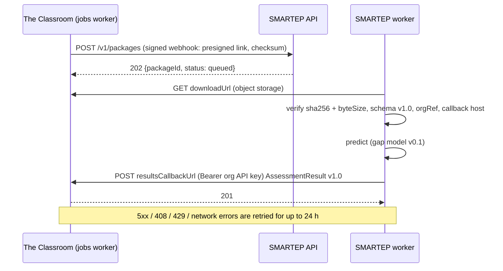

# SMARTEP API: integration contract for The Classroom

Service: `smartep/api/` · image built from `Dockerfile` · target host `api.smartep.co.ke` (spec v3 §11).
This page fixes what the spec (§5, §6) leaves open: how webhooks are signed, and how the API answers.

## 1. Flow



## 2. `POST /v1/packages`

Headers (all required):

| Header | Value |
|---|---|
| `X-SMARTEP-Org` | the organisation's `orgRef` (same as `classroom.orgRef` in the package) |
| `X-SMARTEP-Timestamp` | Unix time in seconds when the request was signed |
| `X-SMARTEP-Signature` | `sha256=` + hex HMAC-SHA256 of `"{timestamp}." + raw request body`, keyed with the org's webhook secret |
| `Content-Type` | `application/json` |

Body: the spec §5 webhook payload, plus one optional field.

```json
{
  "packageId": "…", "schemaVersion": "1.0", "educatorRef": "…", "trigger": "period_end",
  "downloadUrl": "https://media.theclass.co.ke/…presigned…", "downloadExpiresAt": "2026-11-20T10:00:00Z",
  "checksum": "sha256:<64 hex>", "byteSize": 482113,
  "classroomBaseUrl": "https://lms.theclass.co.ke"
}
```

`classroomBaseUrl` (optional) lets SMARTEP call `POST {classroomBaseUrl}/v1/assessment/packages/{packageId}/refresh-url`
(Bearer org API key, response `{"downloadUrl": "…"}`) when the link has expired.

Signing example (TypeScript, Node):

```ts
import { createHmac } from 'node:crypto';
const body = JSON.stringify(payload);
const ts = Math.floor(Date.now() / 1000).toString();
const sig = 'sha256=' + createHmac('sha256', webhookSecret).update(`${ts}.${body}`).digest('hex');
await fetch(`${smartepUrl}/v1/packages`, { method: 'POST', body, headers: {
  'Content-Type': 'application/json', 'X-SMARTEP-Org': orgRef, 'X-SMARTEP-Timestamp': ts, 'X-SMARTEP-Signature': sig } });
```

Responses:

| Code | Meaning | The Classroom should |
|---|---|---|
| 202 | Accepted; `{"packageId", "status": "queued", "duplicate": false}` | mark the package `acknowledged` |
| 202 | Already received; `"duplicate": true`, current status | treat as acknowledged (safe to retry) |
| 401 | Unknown organisation, bad or old signature (timestamp outside ±5 min) | fix config; do not retry blindly |
| 422 | Body invalid, or `downloadUrl` host not allowed for the org | fix the payload |
| 5xx | SMARTEP error | retry with backoff |

The API answers in milliseconds (13 ms median measured); the heavy work happens after the 202.

## 3. Results callback

SMARTEP posts AssessmentResult v1.0 (spec §6; `schemas/assessment-result.v1.json`) to the package's
`classroom.resultsCallbackUrl` with `Authorization: Bearer <org API key>` and `Content-Type: application/json`.
Every result is validated before sending: each gap has at least one evidence item, `catalogueRef`s come
only from the package's snapshot, and `model.trainingData = "synthetic"`, `model.validated = false`.

| Classroom reply | SMARTEP does |
|---|---|
| 200 / 201 / 202 / 204 | marks the job delivered and deletes the result body |
| 408, 429, 5xx, timeout | retries after 30 s, 2 min, 10 min, 30 min, 1 h, 3 h, 6 h … until 24 h after acceptance |
| other 4xx (e.g. 404, 422) | marks the job failed (no retry); visible in the job status |

## 4. Safety rules enforced by SMARTEP

- The download host and the callback host must be on the organisation's allow-list (https only).
- The downloaded bytes must match `checksum` and `byteSize`; the package must pass schema v1.0, carry the
  same `packageId`, and belong to the organisation that signed the webhook.
- Packages are processed in memory and never stored; the result body is deleted once delivered. The job
  table keeps metadata only (status, attempts, model version, latency, error).
- Logs contain package ids, organisation refs, model version, counts and timings, never package content
  or presigned URLs.

## 5. Per-organisation configuration (`SMARTEP_ORGS`)

```json
{"<orgRef>": {"webhook_secret": "<random 32+ bytes>", "results_api_key": "<Classroom org API key>",
              "allowed_download_hosts": ["media.theclass.co.ke"], "allowed_callback_hosts": ["lms.theclass.co.ke"]}}
```

The webhook secret is shared with The Classroom (org setting "SMARTEP endpoint + secret"); the results API key
is created in The Classroom with scope `assessment:results:write`.

## 6. Other routes

- `GET /health`: `{"status": "ok", "model": {...}, "jobs": {status: count}}`; no secrets.
- `GET /v1/packages/{packageId}`: job status for operators, `Authorization: Bearer $SMARTEP_ADMIN_TOKEN`.

## 7. What The Classroom still has to build (spec §3–§6)

Package builder and storage, the signed webhook above, `POST /v1/assessment/results` (and optionally
`refresh-url`), the org settings for the SMARTEP endpoint, secret and API key, and the review screens.
